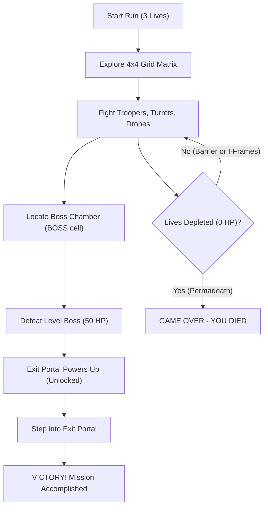

# Boss Defeat Win Condition Implementation Plan

> **For agentic workers:** REQUIRED SUB-SKILL: Use superpowers:subagent-driven-development (recommended) or superpowers:executing-plans to implement this plan task-by-task. Steps use checkbox (`- [ ]`) syntax for tracking.

**Goal:** Modify the win conditions so finding and defeating the Boss is the strict and only win condition, unlocking the Exit Portal for player extraction.

**Architecture:** 
- In `GameScene.ts`, manage an `isPortalUnlocked` boolean flag and `unlockExitPortal()` method.
- Initialize the Exit Portal in a locked red state labeled `'PORTAL LOCKED'`.
- Restrict Boss encounter triggers exclusively to rooms where `cell.type === 'BOSS'`.
- Defeating the Boss flips `isPortalUnlocked = true`, turns the portal green labeled `'EXIT PORTAL'`, and plays a pickup sound.
- Remove the "All Enemies Defeated" victory check; require stepping on the unlocked portal to trigger `triggerVictory()`.

**Tech Stack:** TypeScript, Phaser 3.90+ (Arcade Physics), Vitest (`happy-dom`).

## Global Constraints
- Preserve strict decoupled business logic and pure functions where applicable.
- Inactive entities use body disabling (`body.enable = false`) rather than destruction mid-frame.
- Retain all existing game controls, physics mechanics, and camera culling behaviors.

---

### Task 1: Implement Portal Lock State, Strict Boss Trigger, and Extraction Win Condition

**Files:**
- Modify: `src/scenes/GameScene.ts`
- Test: `tests/game-loop.test.ts`

**Interfaces:**
- Consumes: `SoundManager.getInstance().playSfx('pickup')`, `Boss`, `TilemapRenderer`
- Produces: 
  - `GameScene.isPortalUnlocked: boolean`
  - `GameScene.exitPortalText?: Phaser.GameObjects.Text`
  - `GameScene.unlockExitPortal(): void`

- [ ] **Step 1: Write failing tests in `tests/game-loop.test.ts`**

Add tests to `tests/game-loop.test.ts` verifying:
1. Portal starts in locked state (`isPortalUnlocked === false`).
2. Player overlapping exit portal while `isPortalUnlocked === false` does NOT call `triggerVictory()`.
3. Slaying all regular enemies does NOT call `triggerVictory()`.
4. Defeating the Boss calls `unlockExitPortal()`, setting `isPortalUnlocked = true` and updating portal text to `'EXIT PORTAL'`.
5. Player overlapping exit portal while `isPortalUnlocked === true` calls `triggerVictory()`.
6. Entering a column 3 room where `cell.type !== 'BOSS'` does not trigger the Boss encounter.

- [ ] **Step 2: Run tests to verify they fail**

Run: `npx vitest run tests/game-loop.test.ts`
Expected: FAIL due to missing `isPortalUnlocked`, premature victory on exit portal contact, or lingering all-enemies-dead trigger.

- [ ] **Step 3: Update `src/scenes/GameScene.ts`**

1. Add properties:
   ```ts
   public isPortalUnlocked: boolean = false;
   public exitPortalText?: Phaser.GameObjects.Text;
   ```
2. In `create()`:
   Reset `this.isPortalUnlocked = false;` and `this.exitPortalText = undefined;`.
   When creating `this.exitDoor`:
   ```ts
   if (this.add && typeof this.add.sprite === 'function') {
     const portal = this.add.sprite(exitX, exitY, 'tileset', 4);
     if (typeof portal.setTint === 'function') {
       portal.setTint(0xff4444);
     }
     if (typeof portal.setAlpha === 'function') {
       portal.setAlpha(0.75);
     }
     this.exitDoor = portal;
     this.exitDoors.push(portal);
   }
   if (this.add && typeof this.add.text === 'function') {
     this.exitPortalText = this.add.text(
       exitX,
       exitY - 18,
       'PORTAL LOCKED',
       createRetroTextStyle({
         fontSize: '10px',
         color: '#ff4444',
         strokeThickness: 2,
       })
     ).setOrigin(0.5);
   }
   ```
3. Add `unlockExitPortal()` method:
   ```ts
   public unlockExitPortal(): void {
     this.isPortalUnlocked = true;
     if (this.exitDoor) {
       if (typeof this.exitDoor.clearTint === 'function') {
         this.exitDoor.clearTint();
       }
       if (typeof this.exitDoor.setTint === 'function') {
         this.exitDoor.setTint(0x00ff88);
       }
       if (typeof this.exitDoor.setAlpha === 'function') {
         this.exitDoor.setAlpha(1.0);
       }
     }
     if (this.exitPortalText) {
       if (typeof this.exitPortalText.setText === 'function') {
         this.exitPortalText.setText('EXIT PORTAL');
       }
       if (typeof this.exitPortalText.setColor === 'function') {
         this.exitPortalText.setColor('#00ff88');
       }
     }
     SoundManager.getInstance().playSfx('pickup');
   }
   ```
4. In `update()`:
   - Boss room trigger:
     ```ts
     // 4. Boss Room Trigger only in designated BOSS room cell
     if (!this.bossTriggered && this.grid && this.grid[currentGridY] && this.grid[currentGridY][currentGridX]?.type === 'BOSS') {
       this.triggerBossEncounter(currentGridX, currentGridY);
     }
     ```
   - **Delete** the section checking `allDead` in all enemies (`Check All Enemies Defeated Victory Condition`).
5. In `handleCollisions()`:
   - When bullet kills boss:
     ```ts
     if (killed) {
       if (enemy === this.boss) {
         this.unlockExitPortal();
       }
     }
     ```
   - In exit door check:
     ```ts
     // D. Player vs Level Exit Doors / Portals (requires unlocked portal)
     if (this.isPortalUnlocked) {
       for (let i = 0; i < this.exitDoors.length; i++) {
         const door = this.exitDoors[i];
         if (this.checkOverlap(this.player, door, 8)) {
           this.triggerVictory();
           break;
         }
       }
       if (this.exitDoor && this.checkOverlap(this.player, this.exitDoor, 8)) {
         this.triggerVictory();
       }
     }
     ```

- [ ] **Step 4: Run test suite to verify all tests pass**

Run: `npx vitest run tests/game-loop.test.ts`
Expected: PASS

- [ ] **Step 5: Commit changes**

```bash
git add src/scenes/GameScene.ts tests/game-loop.test.ts
git commit -m "feat: enforce boss defeat and portal unlock as sole win condition"
```

---

### Task 2: Update Game Manual & Architecture Documentation

**Files:**
- Modify: `docs/GAME_MANUAL.md:133-165`

- [ ] **Step 1: Update Winning & Losing Conditions in `docs/GAME_MANUAL.md`**

Update Section 6 mermaid diagram:


Update text:
Explain that the sole victory condition is discovering the Boss Chamber, defeating the Boss Mech to disengage the security lockdown and power up the Exit Portal, and stepping through the portal to extract.

- [ ] **Step 2: Run all repository tests and typechecks**

Run: `npm test && npx tsc --noEmit`
Expected: PASS (all tests passing and zero TypeScript errors)

- [ ] **Step 3: Commit documentation update**

```bash
git add docs/GAME_MANUAL.md
git commit -m "docs: update win condition manual to reflect boss defeat requirement"
```
